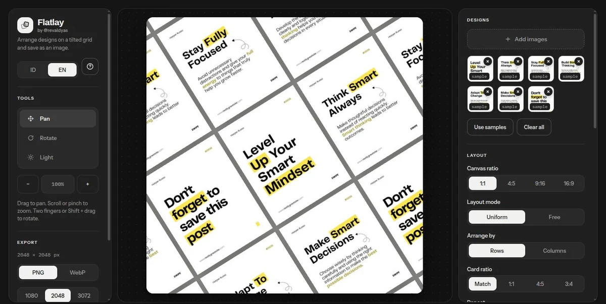
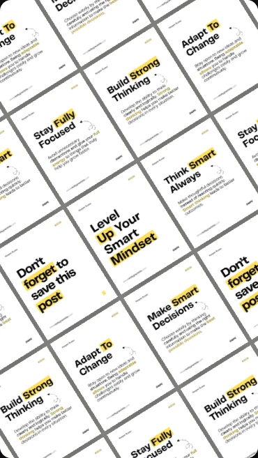
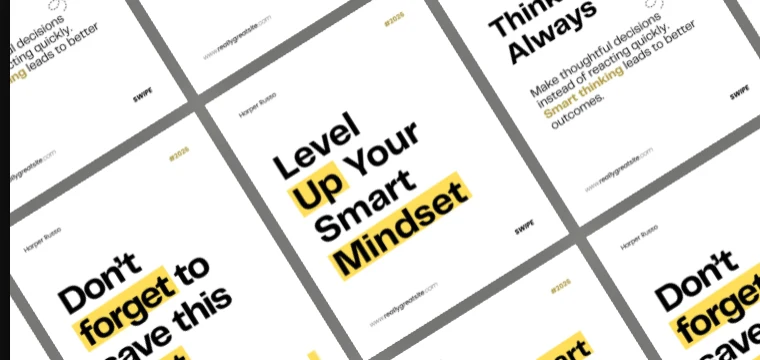
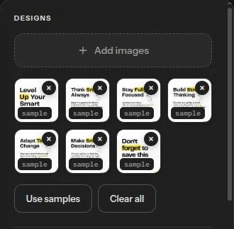
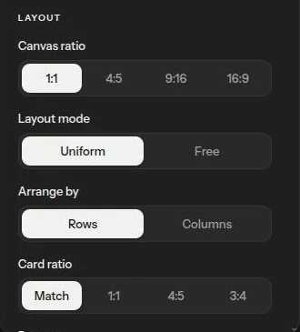
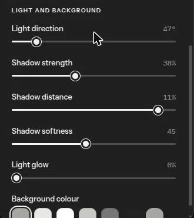
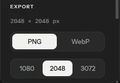
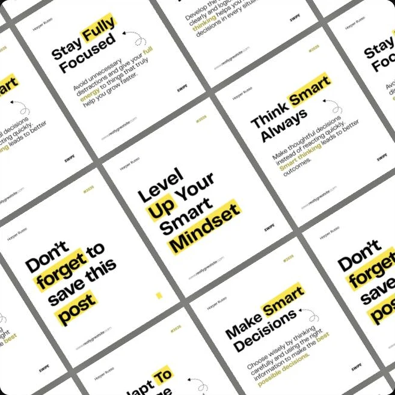
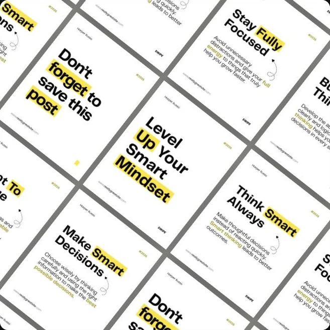

<div align="center">

# Flatlay Mockup

**Turn a pile of card designs into one tilted flat-lay photo.**<br>
Upload, arrange, light it, save as PNG or WebP. Everything runs in your browser.

[**Live demo**](https://flatlay.revaldys.biz.id) · [Features](#features) · [How to use](#how-to-use) · [Run locally](#run-locally) · [Bahasa Indonesia](#bahasa-indonesia)

<br>



</div>

<br>

## Sample results

<table>
  <tr>
    <td width="36%"></td>
    <td width="20%"></td>
    <td width="44%"></td>
  </tr>
  <tr>
    <td align="center"><sub>1:1 post</sub></td>
    <td align="center"><sub>9:16 story</sub></td>
    <td align="center"><sub>16:9 banner</sub></td>
  </tr>
</table>

## Features

- **Canvas ratios:** 1:1, 4:5, 9:16 and 16:9.
- **Two layout modes:** Uniform (same size cards) and Free (each image keeps its own ratio).
- **Repeat or once:** fill the canvas by repeating designs, or show each one a single time.
- **Look controls:** grid angle, card size, spacing, rounded corners, camera tilt, focal length.
- **Light and shadow:** drag the sun to set light direction, then tune shadow strength, distance, softness and glow.
- **Background colour:** presets or any colour from the picker.
- **Export:** PNG or WebP (adjustable quality), up to 3072 px. The result matches the canvas exactly.
- **Indonesian and English** with one click.
- **Private:** images are processed in your browser and never uploaded.

## How to use

<table>
  <tr>
    <td width="25%"></td>
    <td width="25%"></td>
    <td width="25%"></td>
    <td width="25%"></td>
  </tr>
  <tr valign="top">
    <td><b>1. Upload</b><br><sub>Drop files or click to choose. No designs yet? Press <i>Use samples</i>.</sub></td>
    <td><b>2. Layout</b><br><sub>Pick the canvas ratio, Uniform or Free mode, and whether cards repeat.</sub></td>
    <td><b>3. Style</b><br><sub>Adjust tilt, size, gap, corners, shadow, light and background.</sub></td>
    <td><b>4. Save</b><br><sub>Choose PNG or WebP and a size, then press <i>Save</i>.</sub></td>
  </tr>
</table>

### Canvas tools

<table>
  <tr>
    <td width="33%"></td>
    <td width="33%"></td>
    <td width="33%"></td>
  </tr>
  <tr valign="top">
    <td><b>Pan</b><br><sub>Drag to move. Scroll or pinch to zoom.</sub></td>
    <td><b>Rotate</b><br><sub>Drag in a circle to turn the grid, like turning a photo table.</sub></td>
    <td><b>Light</b><br><sub>Drag the sun to change light direction. Shadows follow.</sub></td>
  </tr>
</table>

### Keyboard

Click the canvas first, then:

| Key | Action |
| --- | --- |
| Arrow keys | Pan the canvas |
| `+` / `-` | Zoom in / out |
| `[` / `]` | Turn the grid angle |

## Run locally

No build step. Serve the folder over HTTP (opening `index.html` directly with `file://` can break image loading):

```bash
./serve.sh        # http://localhost:8000
./serve.sh 3000   # custom port
```

Or use any static server, for example `npx serve .`.

## Deploy

Import the repo in Vercel (framework preset: **Other**). No settings needed. Every push to `master` deploys automatically.

## Tech

Plain HTML, CSS and JavaScript with [Three.js](https://threejs.org/) (r128) for rendering. No framework, no bundler.

```
index.html          app (markup, styles, script)
assets/cards/       sample card designs (WebP)
assets/shots/       screenshots used in the About popup and this README
serve.sh            tiny local static server
```

---

## Bahasa Indonesia

Unggah desain kartu atau poster, susun otomatis jadi mockup flat-lay yang miring, lalu simpan sebagai PNG atau WebP. Semua diproses di browser, gambar tidak pernah diunggah ke server.

**Cara pakai singkat:** unggah desain, atur rasio kanvas dan mode layout, poles sudut, bayangan, cahaya dan warna latar, lalu tekan **Simpan**.

**Jalankan lokal:** `./serve.sh`, lalu buka `http://localhost:8000`.

## License

[MIT](LICENSE) · Made by [@revaldyas](https://github.com/revaldyas)
